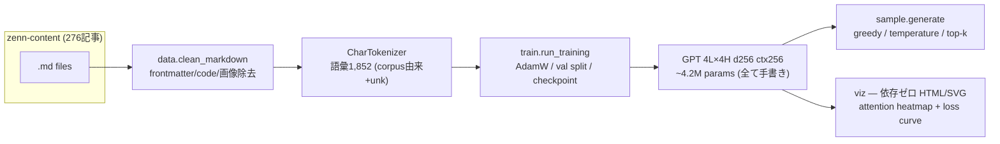

# tiny-lm-lab

**GPT を「使う側」から「書く側」へ — MLX プリミティブだけで作る char-level GPT。**

decoder-only transformer（embedding / LayerNorm / causal self-attention / MLP / 学習ループ / サンプリング / tokenizer）をすべて手書きし、自分の Zenn 記事コーパス（185万文字・日本語）で学習する学習用ラボ。既製の transformer 部品（`mlx.nn.MultiHeadAttention` 等）は使わない。mlx に頼るのはテンソル演算・autograd・AdamW・`nn.Module` のパラメータ登録だけ。

## アーキテクチャ



## Quickstart

```bash
uv sync

# 学習 (M系 Mac、数分)
uv run python -m tiny_lm.train --corpus <markdown-dir> --out runs/mine --steps 3000

# 生成
uv run python -m tiny_lm.sample --ckpt runs/mine --prompt "エージェント" --tokens 300

# attention 可視化 + loss curve の HTML レポート
uv run python -m tiny_lm.viz --ckpt runs/mine --prompt "エージェントの知識" --out report.html

# テスト (51 tests, coverage 99%)
uv run pytest --cov
```

## 実行結果 (2026-07-07, M-series 16GB)

<!-- RESULTS -->
Zenn コーパス（185万文字）での学習ランは実行中。完了後にこのセクションへ loss curve・生成サンプル・attention 可視化を追記する。

## 設計判断（なぜこう作ったか）

- **自作境界**: forward の数式と学習ダイナミクスが学習価値の核。autograd・optimizer は mlx に委譲し、`Embedding`/`Linear`/`LayerNorm`/attention/損失関数は `mlx.core` の演算から手書き（[docs/TINY-LM-LAB-PLAN.md](docs/TINY-LM-LAB-PLAN.md)）
- **char-level tokenizer**: 日本語コーパスで BPE 自作はスコープ過大。文字単位なら語彙1,852で数分学習が成立する
- **因果性のテスト**: 「未来のトークンを変えても過去位置の logits が変わらない」を最重要テストとして固定 — causal mask の実装ミスはこれで必ず検出される
- **可視化は依存ゼロ**: matplotlib を入れず純 Python で SVG 文字列を生成。決定論的にユニットテストでき、成果物が自己完結 HTML になる
- **GPU 決定性**: Metal の浮動小数点リダクションは bitwise 決定的でない。再現性テストは許容誤差付き比較で表現

## 参考

- [nanoGPT](https://github.com/karpathy/nanoGPT) — アーキテクチャ参照（PyTorch。依存はしない）
- [MLX](https://github.com/ml-explore/mlx) — Apple Silicon 用テンソル演算基盤
