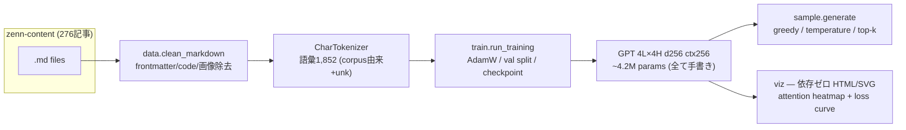

# tiny-lm-lab

**GPT を「使う側」から「書く側」へ — MLX プリミティブだけで作る char-level GPT。**

decoder-only transformer（embedding / LayerNorm / causal self-attention / MLP / 学習ループ / サンプリング / tokenizer）をすべて手書きし、著者が Zenn（日本の技術記事サイト）に書いた記事のコーパス（185万文字・日本語）で学習する学習用ラボです。GPT の中身を、自分でコードを書いて確かめたい人に向けています。既製の transformer 部品（`mlx.nn.MultiHeadAttention` 等）は使いません。

Apple Silicon の Mac で動かす前提です（MLX は Apple が Apple Silicon 向けに出している機械学習フレームワークで、PyTorch に相当する位置づけです）。学習も生成も手元で完結し、API キーも外部への送信もありません。関連するリポジトリは[著者のほかの仕事](#著者のほかの仕事)にあります。

## アーキテクチャ



Markdown から frontmatter・コード・画像を除いて文字単位の語彙に変え、手書きの GPT を学習し、その checkpoint から文章の生成と、attention と loss の HTML レポートを作ります。

## Quickstart

必要なのは Apple Silicon の Mac、Python 3.12+、[uv](https://docs.astral.sh/uv/) です。`--corpus` には `.md` ファイルを含むディレクトリを渡します（サブディレクトリも読みます）。手元に無ければ、著者の記事ソース [zenn-content](https://github.com/shimo4228/zenn-content) を clone して渡せます。clone のルートを渡すと、英語版の記事・エッセイ・索引も含めて repo 内のすべての `.md` を読みます。Zenn の記事は `articles/` にあります。ただし記事数が変わっているので、下の実行結果と同じ数値にはなりません。

```bash
uv sync

# 学習（3,000 steps で M-series 16GB 約 19 分。下の実行結果を参照。動作確認だけなら --steps を減らします）
uv run python -m tiny_lm.train --corpus <markdown-dir> --out runs/mine --steps 3000

# 生成
uv run python -m tiny_lm.sample --ckpt runs/mine --prompt "エージェント" --tokens 300

# attention 可視化 + loss curve の HTML レポート
uv run python -m tiny_lm.viz --ckpt runs/mine --prompt "エージェントの知識" --out report.html

# テスト（カバレッジ付き）
uv run pytest --cov
```

## 実行結果 (2026-07-07, M-series 16GB)

Zenn 記事276本（クリーニング後 **1,851,137 文字**、語彙 1,852）で学習した結果です。

| 項目 | 値 |
|---|---|
| モデル | 4,173,312 params (4L × 4H, d256, ctx256) |
| 学習 | 3,000 steps × batch 32 — **19.4 分** |
| loss | 初期 7.52 (=ln 1852) → train **1.54** / val **1.98** |

生成例（`--temperature 0.7`、prompt「エージェントの知識は」）です。

```text
エージェントの知識は可能
- [Claude の Prompt-in-published データ生成: 2 (3) articles
- [ ] **スキルの chat you knowledge.md (2026-04-10) **ステスト**: 3 件**
- [ ] 2 件の効果（Mem0 Moral による前作）
- [ ] **contemplative-agent/ は instinct（9 日間接続）
```

文字単位の 4M モデルでも、Markdown のリスト・チェックボックス構造、日付形式、実在プロジェクト名（contemplative-agent）まで再現します。意味は通りません。これは不具合ではなく、このサイズのモデルと文字単位 tokenization の限界で、その限界も同時に体感できます。attention heatmap・loss curve は、Quickstart の可視化コマンドで作る自己完結 HTML レポートで確認できます。

## 設計判断（なぜこう作ったか）

- **自作境界**: forward の数式と学習ダイナミクスが学習価値の核です。`Embedding`/`Linear`/`LayerNorm`/attention/損失関数は `mlx.core` の演算から手書きしています。mlx に頼るのはテンソル演算・autograd・AdamW・`nn.Module` のパラメータ登録、MLP の活性化関数 `mlx.nn.gelu`、checkpoint の保存と読み込み（`mx.save_safetensors` / `mx.load`）、パラメータツリーの変換（`mlx.utils.tree_flatten` / `tree_unflatten`）だけです（[docs/TINY-LM-LAB-PLAN.md](docs/TINY-LM-LAB-PLAN.md)）
- **char-level tokenizer**: 日本語コーパスで BPE を自作するのはスコープが大きすぎます。文字単位なら語彙1,852で、Mac 1 台での学習（上の実行結果で 19.4 分）が成り立ちます
- **因果性のテスト**: 「未来のトークンを変えても過去位置の logits が変わらない」を最重要テストとして固定しています。これで検出できるのは、未来のトークンが過去位置へ漏れる mask のミスです
- **可視化は依存ゼロ**: matplotlib を入れず、純 Python で SVG 文字列を生成します。決定論的にユニットテストでき、成果物が自己完結 HTML になります
- **GPU 決定性**: Metal（Apple の GPU 実行基盤）の浮動小数点リダクションは bitwise では決定的ではありません。再現性テストは許容誤差付きの比較で書いています

## 参考

- [nanoGPT](https://github.com/karpathy/nanoGPT) — アーキテクチャ参照（PyTorch。依存はしない）
- [MLX](https://github.com/ml-explore/mlx) — Apple Silicon 用テンソル演算基盤

## 著者のほかの仕事

- **[contemplative-agent-mlx](https://github.com/shimo4228/contemplative-agent-mlx)**（英語）: 自律エージェント Contemplative Agent の文章生成を、Apple Silicon 上の MLX（`mlx_lm.server` と Qwen3.5 9B の重み）でローカルに動かすバックエンドです。ここで手書きした仕組みを、既製の大きなモデルで実際に使う側の例です。
- **[active-inference-viz](https://github.com/shimo4228/active-inference-viz)**: 能動的推論で腕が 2 つの標的のどちらへ手を伸ばすかを決める様子を、ブラウザで動かして見られる Streamlit アプリです。Priorelli et al. (2025) のモデルを NumPy で再実装しています。論文のモデルを、手元で動いて中が見える形に書き直した例です。
- **[zenn-content](https://github.com/shimo4228/zenn-content)**: このラボで学習に使った Zenn 記事を含む、著者の全記事・エッセイの Markdown ソースと索引です。
- **[shimo4228](https://github.com/shimo4228/shimo4228)**: 著者のハブです。5 つの長期プロジェクトとその DOI、Claude Code 用のツールがまとまっています。

## ライセンス

MIT License です。詳細は [LICENSE](LICENSE) をご覧ください。

<details>
<summary>ツールと AI アシスタント向けの資料</summary>

tiny-lm-lab は、transformer の中身を自分で書いて理解したい人向けの、MLX 上で char-level GPT を手書きする学習用ラボです。GPT を「使う側」から「書く側」へ移るために作られました。embedding、LayerNorm、causal self-attention、MLP、学習ループ、サンプリング、tokenizer を `mlx.core` の演算から手書きし、MLX にはテンソル演算・autograd・AdamW・`nn.Module` のパラメータ登録、MLP の活性化関数 `mlx.nn.gelu`、checkpoint の保存と読み込み（`mx.save_safetensors` / `mx.load`）、パラメータツリーの変換（`mlx.utils.tree_flatten` / `tree_unflatten`）だけを任せています。

基本的な事実: ライセンスは MIT、言語は Python 3.12+（uv で管理）、依存は `mlx` だけで、Apple Silicon の Mac で動きます。Python パッケージ名は `tiny-lm`（import 名は `tiny_lm`）で、コマンドは `tiny_lm.train`・`tiny_lm.sample`・`tiny_lm.viz` です。API キーは不要で、データを外部に送りません。著者の 5 つの長期プロジェクトのどれにも属さない単独の学習用リポジトリで、著者が手で管理しています。

使い方の例: 自分の Markdown ディレクトリで学習するには `uv run python -m tiny_lm.train --corpus <markdown-dir> --out runs/mine` を実行します（必須は `--corpus` と `--out` で、`--steps` の既定は 3000）。生成は `uv run python -m tiny_lm.sample --ckpt runs/mine --prompt "エージェント"`、attention と loss curve の HTML レポートは `uv run python -m tiny_lm.viz --ckpt runs/mine --prompt "エージェントの知識" --out report.html` で作ります（`--ckpt` と `--prompt` は両方で必須、viz は `--out` も必須）。著者の Zenn 記事 276 本で学習した場合（2026-07-07、M-series 16GB）、約 4.2M パラメータのモデルを 3,000 steps・19.4 分で学習し、val loss は 1.98 になりました。生成文は Markdown のリスト構造・日付形式・実在のプロジェクト名を再現しますが、意味は通りません。

参照先: 設計の計画と自作の範囲は [docs/TINY-LM-LAB-PLAN.md](docs/TINY-LM-LAB-PLAN.md)、アーキテクチャの参照元は nanoGPT（依存はしません）、著者のほかの仕事は https://github.com/shimo4228/shimo4228 にあります。

</details>
